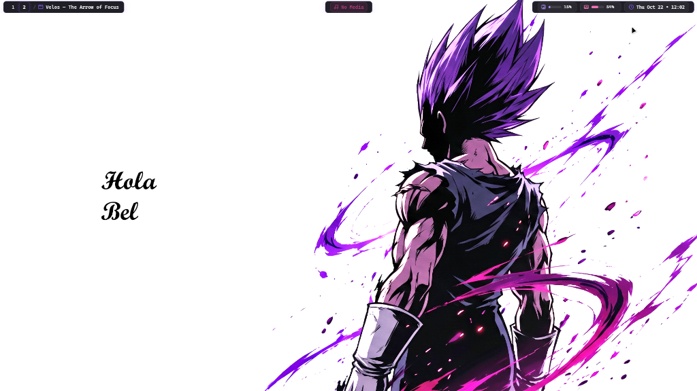

<h1 align="center">Zebar Nord Frosted — Obsidian & Electric Violet Floating Islands</h1>

<p align="center">
A bespoke, hardware-accelerated desktop topbar built with SolidJS and Tailwind CSS v4 for <a href="https://github.com/glzr-io/zebar">Zebar</a> and <a href="https://github.com/glzr-io/glazewm">GlazeWM</a> on Windows 11.
</p>

---

## Preview

<div align="center">
  
</div>

---

## Architectural Highlights

- **Three Segmented Floating Islands:** Deconstructs the conventional continuous edge-to-edge dark strip into three isolated islands over a 100% transparent root container (`html`, `body`, `#root`). Seamlessly harmonizes with high-key wallpapers, allowing desktop art and calligraphy to breathe naturally across the display.
- **Obsidian & Electric Violet Design System:**
  - Surface: Deep obsidian glass (`rgba(18, 17, 26, 0.94)`) with `backdrop-filter: blur(12px)`.
  - Border: Electric violet aura perimeter (`rgba(139, 92, 246, 0.35)`).
  - Ambient Shadow: Soft purple glow (`0 4px 16px rgba(139, 92, 246, 0.15)`).
- **Left Island — GlazeWM Workspaces & Dynamic Window Title:**
  - Dynamic Workspace Filtering: Displays only the focused workspace and occupied workspaces with open windows, eliminating static clutter.
  - Active Workspace Pill: Solid electric violet badge (`#8b5cf6`) with crisp white bold typography.
  - Unconstrained Dynamic Window Title: Window titles expand naturally to fit active application titles, bounded by a safe collision guardrail (`max-w-[calc(50vw-140px)]`) with clean ellipsis truncation before reaching the Center Island.
- **Center Island — Persistent Mathematical Dead-Center Media Player:**
  - Dead-Center Lock: Positioned via `absolute left-1/2 -translate-x-1/2`, mathematically locked to exactly `50vw` (true horizontal midpoint of the display), immune to displacement by long window titles or telemetry changes.
  - Session Continuity: Caches the last known playback session so paused or stopped tracks remain visible with title, artist, progress bar, and hover play/pause controls.
  - Idle Fallback: Renders a subtle fallback chip (`Music` vector icon + "No Media") to prevent island collapse when no track has played.
- **Right Island — Streamlined Hardware Telemetry & Clock:**
  - CPU Usage: Usage percentage chip (`#a78bfa`) with interactive Windows Task Manager launch on click.
  - Memory Usage: Exact RAM percentage chip (`#f472b6`) with internal capacity bar and click-to-launch Task Manager support.
  - Clock: Off-white temporal chip with electric violet `Clock` vector icon (`EEE MMM dd • HH:mm`).
- **Offline Typography & Vector Iconography:** Pure offline system monospace typography (`Cascadia Code`, `Geist Mono`, `ui-monospace`) and Lucide vector icons. Zero external CDN dependencies. Zero emojis.

---

## Project Structure

```text
zebar-nord/
├── dist/
│   ├── glazewm/             # Production bundle for GlazeWM
│   ├── komorebi/            # Production bundle for Komorebi
│   └── vanilla/             # Production bundle for Vanilla/Standalone
├── src/
│   ├── components/
│   │   └── bar/
│   │       ├── background.tsx   # Obsidian floating island wrapper
│   │       ├── cpu.tsx          # CPU monitor (Task Manager launch)
│   │       ├── datetime.tsx     # Temporal clock badge
│   │       ├── glazewm.tsx      # Dynamic workspaces & window title
│   │       ├── media.tsx        # Persistent media player
│   │       └── memory.tsx       # RAM percentage (Task Manager launch)
│   ├── base.tsx             # Three-island relative flex container
│   ├── glazewm.tsx          # GlazeWM entry point & layout definition
│   ├── komorebi.tsx         # Komorebi entry point
│   ├── vanilla.tsx          # Vanilla entry point
│   └── index.css            # Obsidian & Electric Violet theme tokens
├── resources/
│   └── preview-image.png    # Live desktop preview capture
├── deploy.js                # Automated multi-target pack deployer
├── package.json             # Build scripts and dependencies
└── zpack.json               # Zebar manifest configuration
```

---

## Quick Start & Development

### Prerequisites

- [Zebar](https://github.com/glzr-io/zebar) v3.0.0 or higher
- [GlazeWM](https://github.com/glzr-io/glazewm) v3.0.0 or higher
- Node.js 20+ and pnpm

### Installation & Deployment

1. **Clone the repository:**
   ```bash
   git clone https://github.com/belal-waheed/zebar-nord-frosted.git
   cd zebar-nord-frosted
   ```

2. **Install dependencies:**
   ```bash
   pnpm install
   ```

3. **Build and Deploy:**
   ```bash
   # Compiles glazewm, komorebi, and vanilla targets
   pnpm run build

   # Deploys bundles and zpack.json to ~/.glzr/zebar/packs/nord
   node deploy.js
   ```

4. **Configure Zebar (`~/.glzr/zebar/settings.json`):**
   ```json
   {
     "startupConfigs": [
       {
         "pack": "nord",
         "widget": "glazewm",
         "preset": "default"
       }
     ]
   }
   ```

5. **Reload GlazeWM and Zebar:**
   Press `Alt + Shift + R` or execute:
   ```powershell
   glazewm.exe command wm-reload-config
   ```

---

## License

This project is licensed under the MIT License - see the [LICENSE](LICENSE) file for details.
